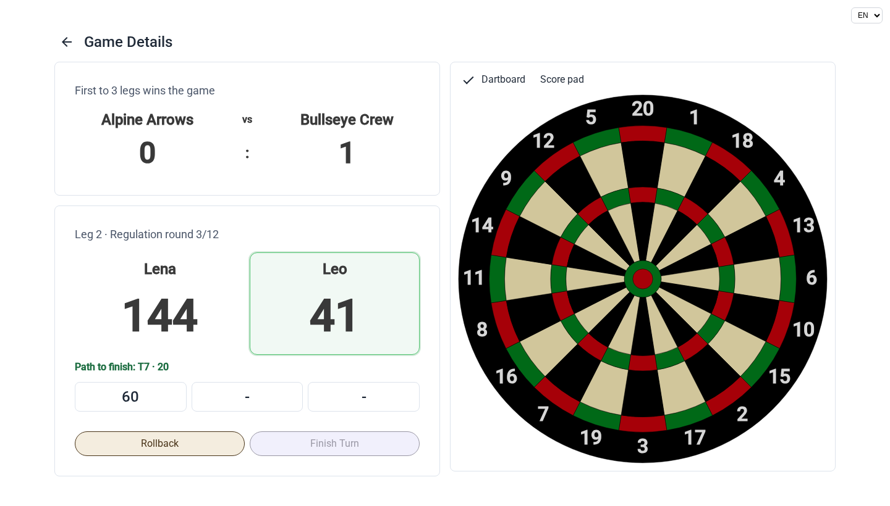
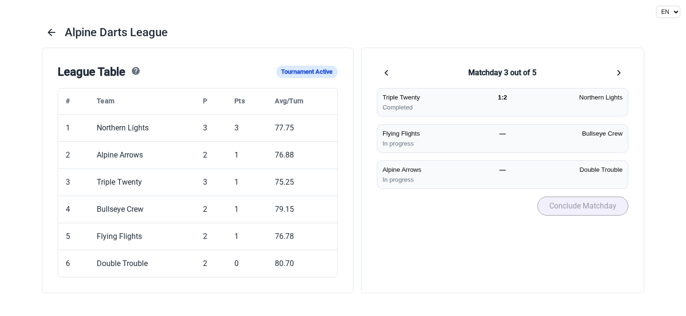
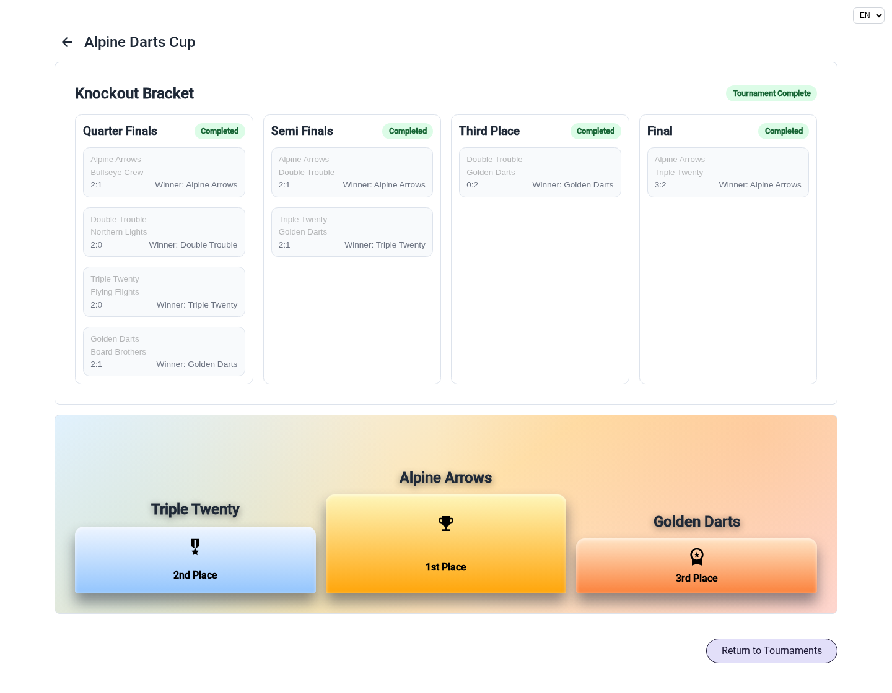

# Darts Tournament

A web application for organizing darts tournaments with two-player teams, recording each dart and tracking match results and standings. It was used at tournaments organized by **ASV Oberwielenbach** on **2 August 2025** and on **1 August 2026**. The application remains under active development.

## Features

- **Teams:** create, edit and delete teams with two named players.
- **Standalone games:** play individual matches with configurable legs to win, regulation rounds and an optional exact score target (e.g. 301 or 501).
- **Score entry:** use an interactive dartboard or score pad, track the current player and turn and correct entries with rollback and back controls.
- **Scoring:** play for the highest score or an exact target with a countdown display and checkout suggestions.
- **League tournaments:** generate matchday pairings, choose games per team and view standings ranked by points, head-to-head results and average score per turn.
- **Knockout tournaments:** configure rules per stage, allow empty slots to advance teams by walkover and optionally include a third-place match.
- **Results:** review completed games, leg results, tournament standings and final placements.
- **Languages:** switch between English and German.

See the [User Guide](USER_GUIDE.md) for step-by-step instructions, scoring rules and tournament progression.

## Screenshots

Screenshots of the current application with sample teams and tournaments.



*Active game with player scores, a suggested checkout, throw rollback and a switch between dartboard and score pad input.*



*League standings with points and average score per turn, alongside completed and ongoing matches on the current matchday.*



*Completed knockout bracket with stage-by-stage results and a podium section highlighting the top three teams.*

## Run with Docker

Install Docker with Docker Compose, then run from the repository root:

```bash
docker compose up --build
```

MongoDB stores its data in the named `mongo_data` volume. Stop the services with `docker compose down`, the database volume is retained.

## Project layout

- `darts-frontend/src/app/` — Angular components, services, models, translations and utilities.
- `darts-backend/src/` — NestJS team, game, leg and tournament modules.
- `docker-compose.yml` — frontend, backend and MongoDB services.
- `USER_GUIDE.md` — instructions for tournament organizers and scorekeepers.
- `docs/screenshots/` — application screenshots.